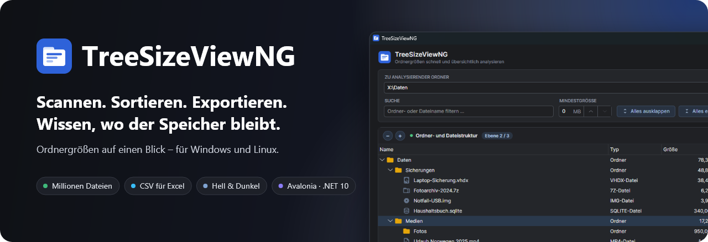
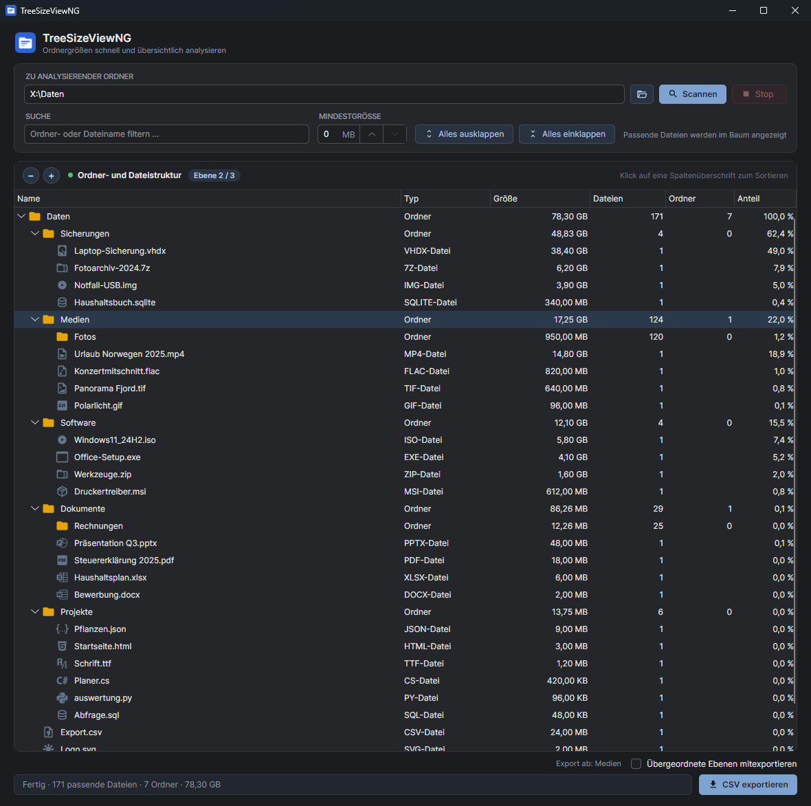

<p align="center">
  
</p>

<p align="center">
  
  
  
  
  
  
  
</p>

<h3 align="center">Wissen, wo der Speicher bleibt.</h3>

<p align="center">
  Ein Laufwerk oder Ordner scannen, sofort sehen, was am meisten Platz belegt – und das Ergebnis für Excel exportieren.<br>
  Eine einzelne Datei, ohne Installation. Ohne Konto, ohne Cloud, ohne Telemetrie.
</p>

---

## Warum TreeSizeViewNG

- **Schnell, auch bei großen Datenmengen:** Der Scan läuft im Hintergrund, die Oberfläche bleibt bedienbar. Sortieren nach Größe
  bleibt selbst bei zwei Millionen Dateien flüssig – sortiert wird im Hintergrund, nicht im Fenster.
- **Auf einen Blick:** Ordner und Dateien in einem Baum, mit Größe, Anzahl Dateien und Ordner, Anteil am Ganzen und einem eigenen
  Symbol für jeden Dateityp. Ebene für Ebene auf- und zuklappen.
- **Auswerten statt nur anschauen:** CSV-Export für Excel mit Größen als echten Zahlen und jeder Ordnerebene in einer eigenen
  Spalte – fertig für Filter und Pivot-Tabellen.
- **Windows und Linux:** eine Oberfläche für beide, als einzelne `.exe` bzw. ausführbare Datei – auf dem Zielrechner muss nichts
  installiert sein.
- **Lokal:** Alles bleibt auf dem eigenen Rechner. Kein Konto, keine Cloud, keine Telemetrie.

---

## So sieht es aus

<p align="center">
  
  
</p>
<p align="center"><sub>Dunkles und helles Design – folgt automatisch der Windows-Einstellung. Aufgenommen mit künstlich erzeugten Beispieldaten.</sub></p>

## Funktionen

- Scan eines Ordners oder ganzen Laufwerks, jederzeit abbrechbar
- Baum mit Ordnern und Dateien: Größe, Anzahl Dateien/Ordner, Anteil in %, Symbole für gängige Dateitypen
  (Dokumente, Office, Bilder, Audio, Video, Archive, Abbilder, Programme, Quellcode, Datenbanken, Schriften …)
- Ebenenweise auf- und zuklappen (− / +) oder alles auf einmal
- Sortieren per Klick auf die Spaltenüberschrift: Zahlenspalten zuerst absteigend (größte zuerst), Namen in natürlicher
  Reihenfolge („Datei2“ vor „Datei10“), erneuter Klick dreht die Reihenfolge um
- Suche nach Ordner- und Dateinamen
- Mindestgröße für berücksichtigte Dateien
- **CSV-Export für Excel** (unten rechts), siehe unten
- Symbolische Links und Junctions werden ignoriert, nicht zugängliche Einträge übersprungen
- Unerwartete Fehler beenden das Programm nicht, sondern erscheinen in der Statusleiste und werden in
  `%LOCALAPPDATA%\TreeSizeViewNG\fehler.log` (Linux: `~/.local/share/TreeSizeViewNG/fehler.log`) protokolliert

## CSV-Export

Eine Zeile pro Ordner bzw. Datei, Trennzeichen und Dezimalzeichen passend zum System (deutsches Excel: `;` und `,`), UTF-8 mit BOM.

| Spalte | Inhalt |
|---|---|
| Typ | `Ordner` oder `Datei` |
| Größe (Bytes) | reine Zahl – zum Summieren, Sortieren und für Pivot-Tabellen |
| Größe (MB), Anteil (%) | Anteil bezogen auf den exportierten Ordner (= 100 %) |
| Dateien, Unterordner, Tiefe, Erweiterung, Name | |
| Ebene 1 … N | jede Ordnerebene in einer eigenen Spalte |
| Vollständiger Pfad | |

- **Ab welchem Ordner:** der im Baum ausgewählte Ordner (bei einer Datei deren Ordner), ohne Auswahl der ganze Scan – immer mit allen
  Unterebenen. Ein aktiver Suchfilter wirkt auch auf den Export.
- **„Übergeordnete Ebenen mitexportieren“:**
  - aus: `C:\ersteEbene\Test` gewählt → Ebene 1 = `Test`
  - an: Ebene 1 = `C:`, Ebene 2 = `ersteEbene`, Ebene 3 = `Test`
- **Summen:** Ordnerzeilen enthalten bereits die Summe ihres Inhalts – für Gesamtsummen nach Typ = `Datei` filtern.
- Excel fasst höchstens ca. 1,05 Mio. Zeilen; für größere Exporte Power Query verwenden oder die Mindestgröße erhöhen.

## Herunterladen

Unter [**Releases**](../../releases/latest) liegen fertige Pakete:

| System | Datei | Start |
|---|---|---|
| Windows x64 | `TreeSizeViewNG-<Version>-windows-x64.exe` | Doppelklick |
| Linux x64 | `TreeSizeViewNG-<Version>-linux-x64.tar.gz` | `tar -xzf TreeSizeViewNG-*-linux-x64.tar.gz && ./TreeSizeViewNG` |

Die Pakete entstehen automatisch bei jedem Push auf `main`, der das Programm ändert (`.github/workflows/release.yml`; reine
Änderungen an Startseite und Dokumentation erzeugen kein Release). Version = Haupt-/Nebenversion aus `<Version>` im csproj plus
laufende Nummer, die an das letzte Release anschließt, z. B. `v1.0.0`, `v1.0.1` … Für einen Sprung auf `1.1.x` nur `<Version>` im
csproj ändern.

## Entwickeln

1. .NET 10 SDK installieren (`global.json` verlangt ein stabiles .NET-10-SDK).
2. `TreeSizeViewNG.sln` in Rider oder Visual Studio öffnen und starten.

### Windows veröffentlichen

`publish-windows.cmd` starten. Ergebnis: `publish/windows-x64/TreeSizeViewNG.exe`.

Veröffentlicht wird als **ReadyToRun** (vorkompiliert, unkomprimiert). Das startete in Messungen am schnellsten – schneller als Native
AOT, bei dem Avalonia/Skia länger zum Initialisieren braucht, und schneller als eine komprimierte Einzeldatei, die bei jedem Start erst
entpackt wird. Preis: die exe ist ca. 136 MB groß.

### Linux veröffentlichen

```bash
chmod +x publish-linux.sh   # einmalig, falls das Ausführungsrecht fehlt
./publish-linux.sh          # Auswahl: 1 Linux x64, 2 Windows x64, 3 beide
```

Ausgabe unter `publish/linux-x64/` bzw. `publish/windows-x64/`. Dieses Skript erzeugt (noch) eine komprimierte Einzeldatei.

### Programmsymbol und Startseite

```bash
dotnet run --file tools/make-icon.cs                 # Assets/app.ico und Assets/Icon.png
dotnet run --file tools/startseite/make-banner.cs    # docs/bilder/banner.png
```

Das Banner nutzt den Screenshot `docs/bilder/hauptfenster-dunkel.png`. Die Screenshots sind mit künstlich erzeugten Beispieldaten
aufgenommen (erfundene Datei- und Ordnernamen), nicht mit echten Daten.

### Paketversionen

Avalonia bleibt bewusst bei der neuesten **11er-Version**: TreeDataGrid ab 11.2 und alle 12.x-Versionen benötigen eine kostenpflichtige
„Avalonia Accelerate“-Lizenz. TreeDataGrid 11.1.0 ist die letzte MIT-Version und läuft mit jeder Avalonia-11-Version; Avalonia 12 würde
TreeDataGrid 12 voraussetzen. Material.Icons.Avalonia 2.3.1 ist die letzte Version für Avalonia 11.

## Lizenz

[MIT](LICENSE)
