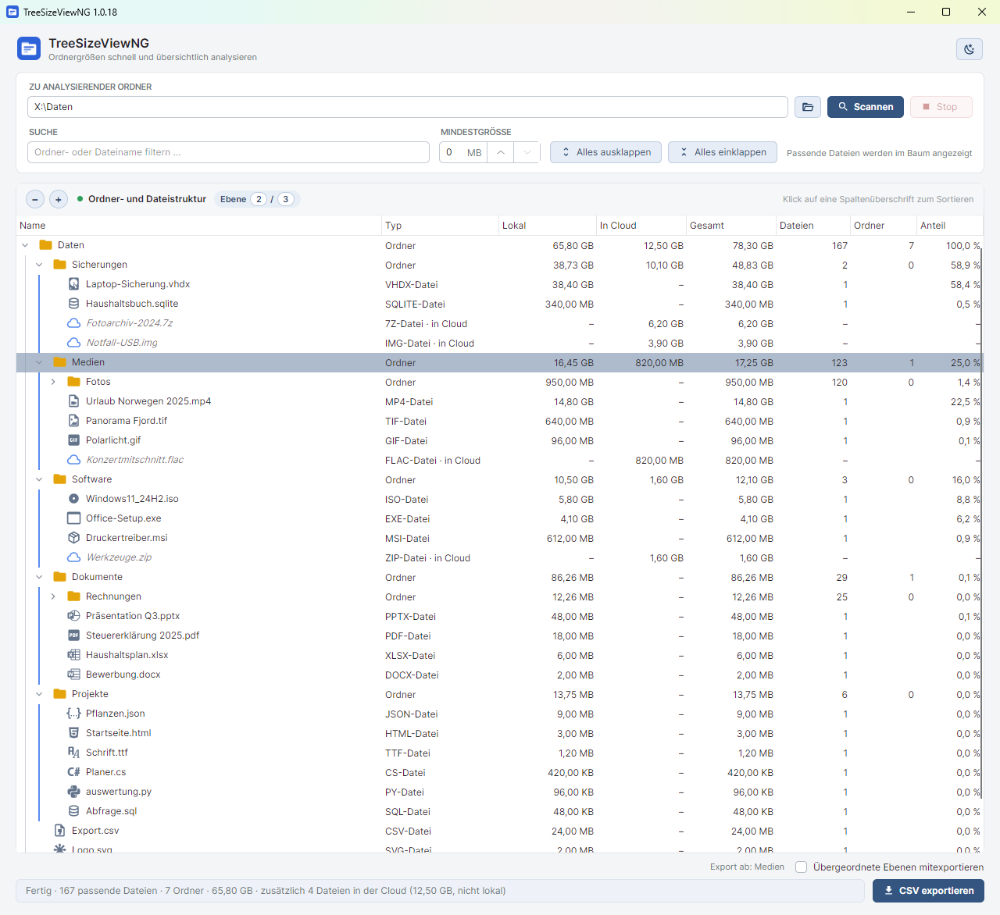

<p align="center">
  
</p>

<p align="center">
  
  
  
  
  
  
  
  
</p>

<h3 align="center">Wissen, wo der Speicher bleibt.</h3>

<p align="center">
  Ein Laufwerk oder Ordner scannen, sofort sehen, was am meisten Platz belegt – und das Ergebnis für Excel exportieren.<br>
  Eine einzelne Datei, ohne Installation. Ohne Konto, ohne Cloud, ohne Telemetrie.
</p>

---

## Warum TreeSizeViewNG

- **Schnell, auch bei großen Datenmengen:** Schon während des Scans erscheinen die obersten Ordner mit wachsenden Größen.
  Bei zwei Millionen Dateien dauert Sortieren rund eine halbe Sekunde (parallel auf allen CPU-Kernen), Auf- und Zuklappen
  ganzer Ebenen Bruchteile einer Sekunde.
- **Auf einen Blick:** Ordner und Dateien in einem Baum, mit Größe, Anzahl Dateien und Ordner, Anteil am Ganzen und einem eigenen
  Symbol für jeden Dateityp. Ebene für Ebene auf- und zuklappen.
- **Auswerten statt nur anschauen:** CSV-Export für Excel mit Größen als echten Zahlen und jeder Ordnerebene in einer eigenen
  Spalte – fertig für Filter und Pivot-Tabellen.
- **Windows und Linux:** eine Oberfläche für beide, als einzelne `.exe` bzw. ausführbare Datei – auf dem Zielrechner muss nichts
  installiert sein.
- **Lokal:** Alles bleibt auf dem eigenen Rechner. Kein Konto, keine Cloud, keine Telemetrie.

---

## So sieht es aus

<p align="center">
  
  
</p>
<p align="center"><sub>Dunkles und helles Design – folgt automatisch der Windows-Einstellung. Aufgenommen mit künstlich erzeugten Beispieldaten.</sub></p>

## Funktionen

- Scan eines Ordners oder ganzen Laufwerks, jederzeit abbrechbar
- Baum mit Ordnern und Dateien: Größe, Anzahl Dateien/Ordner, Anteil in %, Symbole für gängige Dateitypen
  (Dokumente, Office, Bilder, Audio, Video, Archive, Abbilder, Programme, Quellcode, Datenbanken, Schriften …)
- Einzelne Ordner jederzeit per Pfeil oder Doppelklick auf- und zuklappen; **− / +** über dem Baum setzt alle Ordner einheitlich eine Ebene
  höher bzw. tiefer (auch einzeln weiter aufgeklappte werden auf diese Ebene gebracht), dazu alles auf einmal auf- oder zuklappen
- Sortieren per Klick auf die Spaltenüberschrift: Zahlenspalten zuerst absteigend (größte zuerst), Namen in natürlicher
  Reihenfolge („Datei2“ vor „Datei10“), erneuter Klick dreht die Reihenfolge um
- Helles und dunkles Design: folgt dem Betriebssystem, per Schalter oben rechts von Hand umschaltbar (die Wahl wird gemerkt)
- Schon während des Scans sichtbar: oberste Ordner mit wachsenden Größen, Ordner lassen sich dabei bereits aufklappen
- Suche nach Ordner- und Dateinamen
- **Cloud-Dateien getrennt:** Dateien, die nur online liegen (z. B. OneDrive „Dateien bei Bedarf“), werden mit Wolkensymbol
  angezeigt und zählen nicht zur belegten Größe. Findet der Scan solche Dateien, zeigt der Baum drei Größen:
  „Lokal“, „In Cloud“ und „Gesamt“. Dateien in Sync-Ordnern, die lokal vorliegen, zählen normal mit.
- Mindestgröße für berücksichtigte Dateien
- **CSV-Export für Excel** (unten rechts), siehe unten
- **Deutsch und Englisch:** Ist das Betriebssystem auf Deutsch eingestellt, ist die Oberfläche deutsch, sonst englisch.
  Erzwingen lässt sich die Sprache mit der Umgebungsvariablen `TREESIZEVIEWNG_LANG=de` bzw. `=en`. Zahlen und Datum folgen
  weiterhin der Regionaleinstellung.
- Symbolische Links und Junctions werden ignoriert, nicht zugängliche Einträge übersprungen
- Unerwartete Fehler beenden das Programm nicht, sondern erscheinen in der Statusleiste und werden in
  `%LOCALAPPDATA%\TreeSizeViewNG\fehler.log` (englische Oberfläche: `error.log`; Linux: `~/.local/share/TreeSizeViewNG/`)
  protokolliert

## CSV-Export

Eine Zeile pro Ordner bzw. Datei, Trennzeichen und Dezimalzeichen passend zum System (deutsches Excel: `;` und `,`), UTF-8 mit BOM.
Die Spaltenüberschriften sind in der Sprache der Oberfläche (englisch z. B. `Type`, `Size (bytes)`, `Level 1`).

| Spalte | Inhalt |
|---|---|
| Typ | `Ordner` oder `Datei` |
| Lokal (Bytes), In Cloud (Bytes), Gesamt (Bytes) | reine Zahlen – zum Summieren, Sortieren und für Pivot-Tabellen |
| Lokal (MB), Anteil (%) | Anteil bezogen auf den exportierten Ordner (= 100 %), jeweils lokal |
| Dateien, Unterordner, Tiefe, Erweiterung, Name | |
| Ebene 1 … N | jede Ordnerebene in einer eigenen Spalte |
| Vollständiger Pfad | |

- **Ab welchem Ordner:** der im Baum ausgewählte Ordner (bei einer Datei deren Ordner), ohne Auswahl der ganze Scan – immer mit allen
  Unterebenen. Ein aktiver Suchfilter wirkt auch auf den Export.
- **„Übergeordnete Ebenen mitexportieren“:**
  - aus: `C:\ersteEbene\Test` gewählt → Ebene 1 = `Test`
  - an: Ebene 1 = `C:`, Ebene 2 = `ersteEbene`, Ebene 3 = `Test`
- **Summen:** Ordnerzeilen enthalten bereits die Summe ihres Inhalts – für Gesamtsummen nach Typ = `Datei` filtern.
- Excel fasst höchstens ca. 1,05 Mio. Zeilen; für größere Exporte Power Query verwenden oder die Mindestgröße erhöhen.

## Herunterladen

Unter [**Releases**](../../releases/latest) liegen fertige Pakete:

| System | Datei | Start |
|---|---|---|
| Windows x64 | `TreeSizeViewNG-<Version>-windows-x64.zip` | entpacken, `TreeSizeViewNG.exe` starten |
| Linux x64 | `TreeSizeViewNG-<Version>-linux-x64.tar.gz` | `tar -xzf TreeSizeViewNG-*-linux-x64.tar.gz && ./TreeSizeViewNG` |

Die Pakete entstehen automatisch bei jedem Push auf `main`, der das Programm ändert (`.github/workflows/release.yml`; reine
Änderungen an Startseite und Dokumentation erzeugen kein Release).

**Versionsnummer:** `<VersionBase>` aus dem csproj plus Anzahl der Git-Commits, z. B. `1.0.10` – jeder Commit zählt die letzte
Stelle um 1 hoch. Sie steht in der Titelleiste, in den Eigenschaften der exe und im Namen der Pakete (auch der lokal mit
`publish-windows.cmd` erzeugten ZIP). Für einen Sprung auf `1.1.x` nur `<VersionBase>` ändern.

## SOLIDWORKS PDM

Liegt im gescannten Bereich die lokale Ansicht eines PDM-Tresors, fragt TreeSizeViewNG zusätzlich den installierten
PDM-Client, welche Dateien der Tresor enthält – auch die, die noch nicht abgerufen wurden und deshalb gar nicht auf der
Platte liegen (der Explorer zeigt sie nur über die PDM-Erweiterung).

- Die Abfrage startet zusammen mit dem Scan und hat eine eigene Fortschrittszeile je Tresor.
- **Lokal** = Kopie auf der Platte, **In Cloud** = Größe im Tresor (auch wenn die Datei lokal vorliegt),
  **Gesamt** zählt jede Datei einmal. „Gesamt“ ist deshalb bei PDM nicht „Lokal“ + „In Cloud“.
- Dateien nur im Tresor: „· im Tresor“ in der Typ-Spalte, Tresor-Symbol, kursiv.
- **Orange** in „In Cloud“: Die lokale Kopie hat eine andere Größe als die Datei im Tresor (bei Ordnern: sie enthalten so eine Datei).
- Es wird nur gelesen – nichts abgerufen, ausgecheckt oder geändert. Angemeldet wird über den PDM-Client; die App kennt
  keine Zugangsdaten und zeigt nur, was der angemeldete Benutzer in PDM sehen darf.
- Nur unter Windows mit installiertem PDM-Client. Leere Ordner, die es nur im Tresor gibt, erscheinen nicht.

Technik: `Services/PdmVaultReader.cs` (COM-Objekt `ConisioLib.EdmVault`, Suche über `IEdmSearch5`); `tools/pdm-probe.ps1`
zeigt, was die Schnittstelle auf einem Rechner liefert.

## Entwickeln

1. .NET 10 SDK installieren (`global.json` verlangt ein stabiles .NET-10-SDK).
2. `TreeSizeViewNG.sln` in Rider oder Visual Studio öffnen und starten.

### Windows veröffentlichen

`publish-windows.cmd` starten. Ergebnis: `publish/windows-x64/TreeSizeViewNG.exe`.

Veröffentlicht wird als **ReadyToRun** (vorkompiliert, unkomprimiert). Das startete in Messungen am schnellsten – schneller als Native
AOT, bei dem Avalonia/Skia länger zum Initialisieren braucht, und schneller als eine komprimierte Einzeldatei, die bei jedem Start erst
entpackt wird. Preis: die exe ist ca. 136 MB groß.

### Linux veröffentlichen

```bash
chmod +x publish-linux.sh   # einmalig, falls das Ausführungsrecht fehlt
./publish-linux.sh          # Auswahl: 1 Linux x64, 2 Windows x64, 3 beide
```

Ausgabe unter `publish/linux-x64/` bzw. `publish/windows-x64/`. Dieses Skript erzeugt (noch) eine komprimierte Einzeldatei.

### Programmsymbol und Startseite

```bash
dotnet run --file tools/make-icon.cs                 # Assets/app.ico und Assets/Icon.png
dotnet run --file tools/startseite/make-banner.cs    # docs/bilder/banner.png
```

Das Banner nutzt den Screenshot `docs/bilder/hauptfenster-dunkel.png`. Die Screenshots sind mit künstlich erzeugten Beispieldaten
aufgenommen (erfundene Datei- und Ordnernamen), nicht mit echten Daten.

### Paketversionen

Avalonia bleibt bewusst bei der neuesten **11er-Version**: TreeDataGrid ab 11.2 und alle 12.x-Versionen benötigen eine kostenpflichtige
„Avalonia Accelerate“-Lizenz. TreeDataGrid 11.1.0 ist die letzte MIT-Version und läuft mit jeder Avalonia-11-Version; Avalonia 12 würde
TreeDataGrid 12 voraussetzen. Material.Icons.Avalonia 2.3.1 ist die letzte Version für Avalonia 11.

## Lizenz

[MIT](LICENSE)
